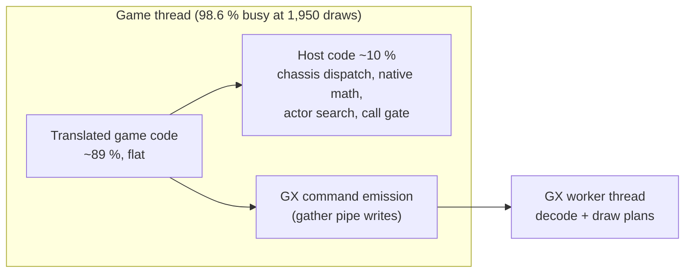

# TECH_PLAN — The game thread at busy views

Status: Planned — follows #586
[Product brief](PRD.md) · [Tracker](PROGRESS.md)

## Where the game thread's time goes

The GX worker's decoding and draw building run on their own thread and are not on the game thread's time.

Top of the game thread's profile at `8-busiest` (perf, all samples on the thread):

| Self % | Where | Symbol |
|---:|---|---|
| 1.50 | translated | `func_800A56E0` |
| 1.17 | translated module | `chassis_dispatch` |
| 1.17 | translated module | `bluewake_native_math_try` |
| 1.06 | host | `host_actor_search_native` |
| 0.95 | host | `bluewake_host_main` |
| 0.92 | translated | `func_803216E0` |
| 0.47 | host | `host_chassis_requires_full` |
| 0.46 | translated module | `bw_call_translated` |

Most samples are `[JIT]`: the translated code copied to 2 MB pages has no symbols for perf.

## How it is measured

1. **Names first.** Profile `8-busiest` with huge pages off (`BLUEWAKE_MODULE_HUGEPAGES=0`), or map the copy's addresses back to the module, so the 89 % is attributed to `func_ADDR` chunks. Look the chunks up in `config/GZLE01/symbols.txt` (docs/PROFILING.md). Group them by game system: actor update, model and joint calculation, draw list building, collision.
2. **Per-frame counts.** The game's work at this view, counted per frame where cheap: actors updated, joints calculated, display lists issued, draws.
3. **Speed** in Game Mode with #590, 6+ launches each way, plus guest checkpoints for exactness.

## Candidates

| Kind | Example | Notes |
|---|---|---|
| Native replacements | Hot math or matrix routines replaced by exact host code, like `bluewake_native_math_try` | Must give identical results bit for bit |
| Dispatch cost | The chassis dispatch and call gate on hot paths (`chassis_dispatch`, `bw_call_translated`, `host_chassis_requires_full`) | Direct calls already on by default (#567); look for remaining indirect calls in hot loops |
| Repeated work | Per-frame joint or matrix work for models that didn't move | Only where the game's state proves nothing changed |
| GX emission | The game's writes of draw commands to the gather pipe | Measure its share first |

Each candidate starts as an opt-in switch, is checked exact by guest checkpoints, and is measured in Game Mode.
