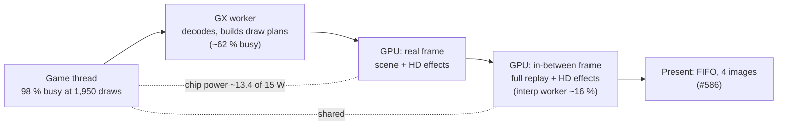
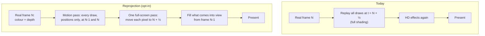

# TECH_PLAN — The GPU's share at busy views: HD effects, power and Smooth Motion

Status: Planned — follows #586
[Product brief](PRD.md) · [Tracker](PROGRESS.md)

## Where a busy frame goes

The CPU and GPU draw from one power budget. While the GPU is busy at a high clock, the CPU cores get less, and the game thread is the CPU's bottleneck. Cutting GPU work therefore helps twice at this view.

## How it is measured

Game Mode, through the owner's Steam shortcut. Until #590's dedicated shortcut exists, use the guarded hook in `~/BlueWake-game-mode.sh`, which reads `~/bluewake-gm-bench.env` only while it exists. One sampler logs, every 0.25 s and tagged with the running launch:
- GPU busy %, GPU clock and chip power (`hwmon`);
- **each CPU core's clock** (`/sys/devices/system/cpu/cpu*/cpufreq/scaling_cur_freq`), new here, so the power sharing is measured rather than inferred.

Per launch, the session log gives game frames a second, game-thread busy, GPU time per frame (`[gpu-prof]`) and draws per frame.

## Part 1: the HD effects at the busiest view

| Step | What | Done when |
|---|---|---|
| 1a | At `8-busiest`, each HD effect off in turn (AO, cloud shadows, edge light, torch light, far blur, bloom), plus Smooth Motion off and HD look off, 3 launches each, with the CPU clock logged | A table of fps, GPU time, GPU and CPU clocks and power per setup |
| 1b | Make the largest cheaper, exactly or within one shade step. Candidates from #586's other options: the far blur (5.2 % at lighter views, never optimised), fusing the per-pixel effects (B2), storing nothing a later pass doesn't read (B3) | Opt-in switch, ahead in every launch, pictures |

## Part 2: Smooth Motion by reprojection

Today the in-between frame replays every draw at blended transforms, then runs the HD effects again: about 60 % of a real frame's GPU time, plus the interp worker's CPU time.

The game has no motion vectors, but Aurora's replay already knows each draw's transforms in both frames. A positions-only pass writes per-pixel motion without textures, lighting or effects. A full-screen pass then moves the finished frame's pixels halfway along it. Regions that only come into view between the frames are filled from the previous frame.

| Step | What | Done when |
|---|---|---|
| 2a | Measure the in-between frame's share at `8-busiest`: GPU time (`[gpu-prof]` frame totals) and interp worker CPU | Baseline numbers |
| 2b | Prototype, opt-in: motion pass plus warp, no fill; pictures against today's in-between frames with Smooth Motion's dump | GPU time and the worst differences known |
| 2c | Hole fill and edge handling; owner's play test | Feels like today's Smooth Motion; fps measured in Game Mode |

Risks: transparent and blended draws (water, smoke, particles) have no single depth, and the HUD must be drawn after the warp, not warped with the scene. Both need handling in 2b.

## Leads, in order

| # | Lead | Evidence |
|---|---|---|
| L1 | Reprojection | Smooth Motion off +13 % at `8-busiest` |
| L2 | The largest HD effect at busy views | HD look off +10 %, mostly through power |
| L3 | Lower GPU clock for the same work (power to the CPU) | To be measured in 1a with the CPU clock |
