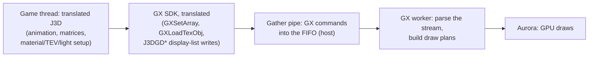

# TECH_PLAN — The draw side of the game thread

Status: Planned — follows #592
[Product brief](PRD.md) · [Tracker](PROGRESS.md)

## How a model is drawn today

Every step before C runs as translated PowerPC code on the game thread. That is the draw side's 26 M cycles a frame at the busiest view, plus a share of the host's 14 M. Step D runs on its own worker.

## Phase 1: the native sets (#451)

Elliott Tate's natives replay translated functions natively, exact to the cycle. Their generators read the prepared chunk source and turn each leaf into C:
- `scripts/windows/native_leaf_gen.py`: rounds 2, 3 and 7 (`--native-entries`);
- `scripts/windows/native_gx_gen.py`: round 5, the GX FIFO writers (`--native-gx`).

Round 4 (`--native-set4`: animation, actor collision, the environment light) goes through the same generators.

#451 found two blockers on a current tree:

| Blocker | Cause | Fix to try |
|---|---|---|
| `unhandled ctx: bw_write32_ato(&bw_ool, ctx, …)` | Lean deadlines (#277, default) emit an `_ato` form of every memory access, with an out-of-line flag the deadline accounting reads; the generators know only `_at` | Teach both generators the `_ato` forms, keeping the out-of-line flag's effect on the deadline accounting exactly (the native must charge what the translation charges) |
| `… is not a block leader` | The recorded leaves and their `native_*_list.h` entries come from a prepared-block layout that today's default (lean blocks, lean memory, lean deadlines, behaviour timing) no longer produces | Generate from the layout the default build produces; re-derive the leaf boundaries; re-certify each leaf against the current module (its comparison tests) |

Then, per set:
1. Build, with its comparison tests (`tests/` x86_64 comparisons: anim, cc, kankyo, gx, leaf).
2. Measure it headless, paced: on against off, `8-busiest` and the five bench scenes, 6 launches each way, guest checkpoints identical.
3. Keep it opt-in behind a menu switch if it is ahead in every launch.

## Phase 2: drawing at the API level (only if needed)

Candidates, in order of what the busiest view spends:

| Path | Today | API-level form |
|---|---|---|
| Material, TEV and light setup per draw (`dScnKy_env_light_c::settingTevStruct*`, `J3DGD*` writes) | Translated code writes GX registers into a display list, which the GX worker parses back | The host sets Aurora's material state directly from the game's material and light structures |
| Shape drawing (`J3DShape`, `J3DShapeMtx*`, `GXCallDisplayList`) | Matrices and display-list calls through the FIFO | Draw calls with the shape's cached vertex data and matrices |
| Model animation (`J3DAnmTransformKey::calcTransform`, `J3DMtxCalcMaya`) | Translated, per joint | Native from the decompilation's source, plays the same |

Each would be a prototype of one path with the translation as the fallback, judged by "plays the same", pictures and Deck speed.

## Risks

- **Phase 1:** the out-of-line accounting may not be reproducible natively at reasonable cost. Then a set is exact only with lean deadlines off, which costs more than it gains.
- **Phase 2:** the HD look and Smooth Motion read the GX stream (draw tags, matrices for the in-between frame), so an API-level path has to feed them the same information.
