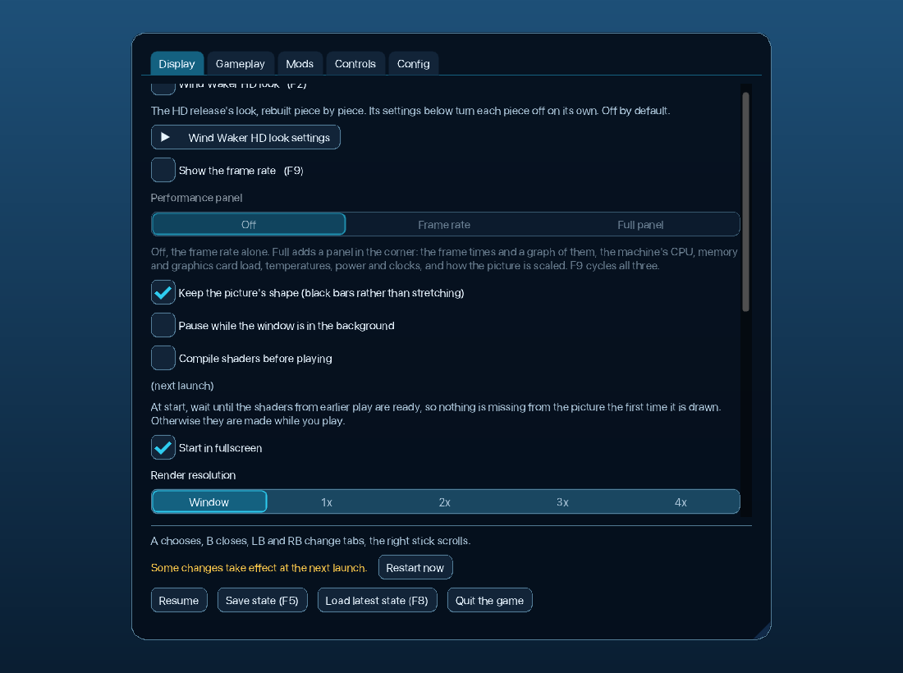
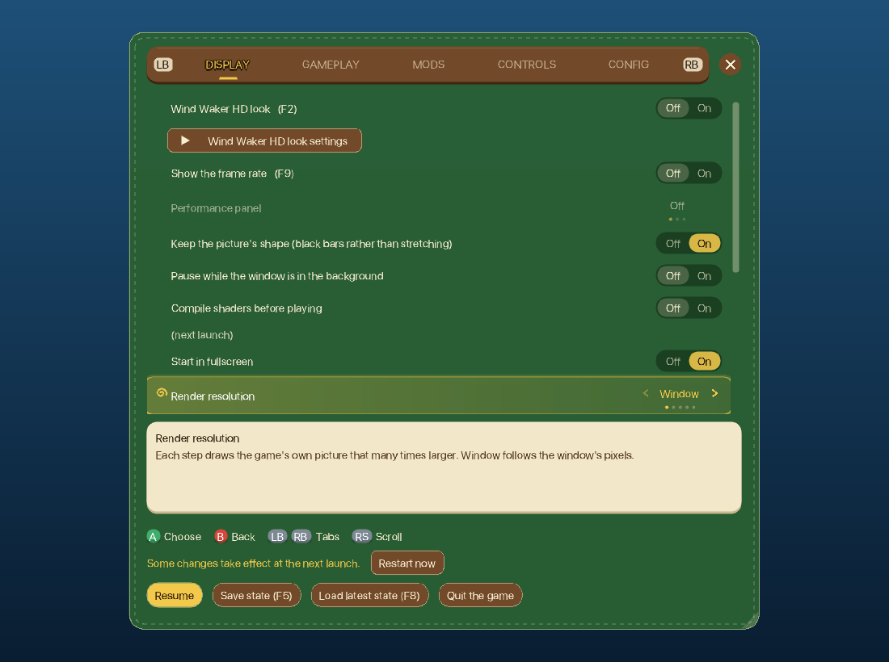
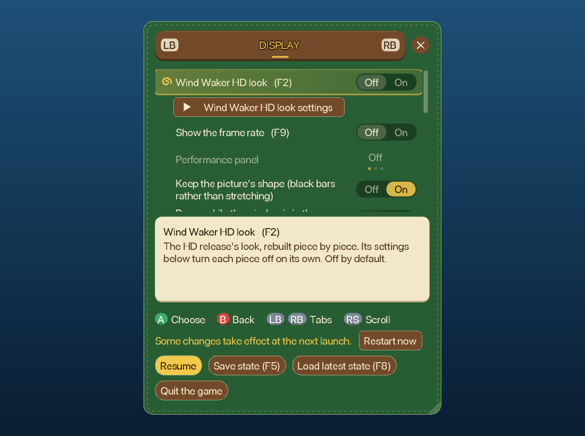

# The settings menu in Wind Waker's style (November 16, 2026)

The desktop menu (Mac, Linux, Windows) takes its look from the game's own menus, modernised, and draws all of it in
code: nothing in it comes from the disc.

- **Taken from the game:** green leaf panels, the title on a wooden plaque in gold outlined in dark brown, the file
  screen's cream stitching (here round the panel), the wind's swirl (here the cursor), the A and B glyphs, and paging
  with the shoulder buttons.
- **Made modern:** a calm panel without the game's jagged edges; one gold light that glides from row to row instead of
  the game's highlight; the arrows show on the lit row only; Off/On pills, choices with a dot each and sliders with a
  diamond; each setting's note on a cream slip under the list, as the game's options explain the chosen one, so the
  list itself is shorter.

Where it is drawn: the colours and drawing helpers in `runtime/host/src/desktop_theme.h`, the rows, plaque, slip and
footer in `runtime/host/src/menu_shared.h`, the table's rows in `runtime/host/src/menu_draw.h`, and the window in
`runtime/host/src/desktop_menu.cpp`. The iPhone, iPad and Android menus are native and unchanged.

The pictures were drawn offscreen from these headers (SDL's software renderer), over a plain background rather than
the game. Rows that draw a control of their own in the game are stand-ins there.

| Before | After |
| --- | --- |
|  |  |

A narrow window at the largest text size: only the open tab's name shows on the plaque.

