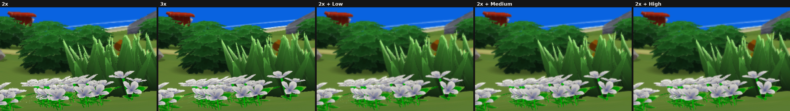
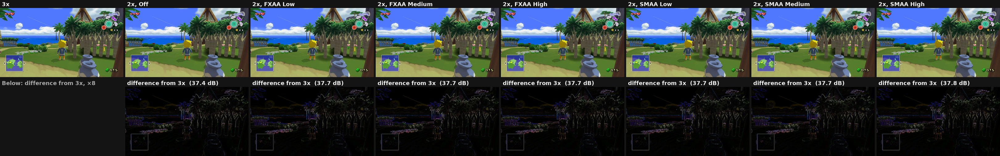
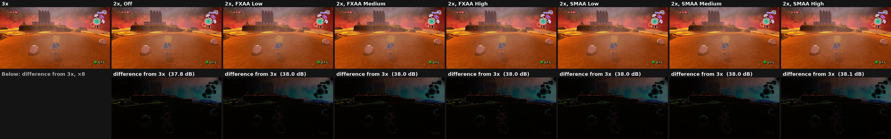
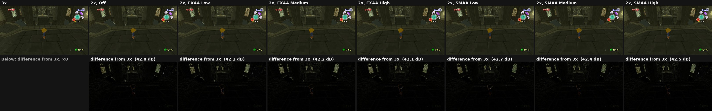
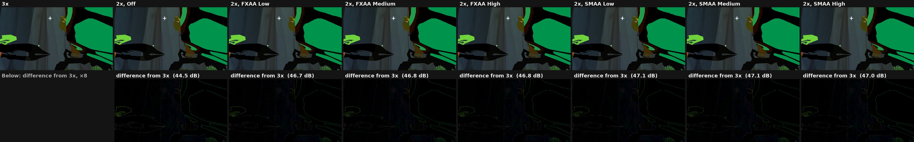
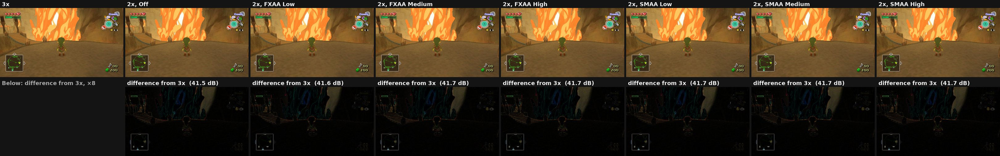

# Progress — Edge smoothing (FXAA) for lower render resolutions

[Product brief](PRD.md) · [Technical plan](TECH_PLAN.md) · [Progress](PROGRESS.md)

- 2026-11-24: the owner found the game runs much better at 2x on the Deck and saw barely any difference from 3x. The sizes worked out from the renderer's code (2x 1707×960, 3x 2560×1440, shown at 1280×720). FXAA chosen over SMAA for the first step; SMAA and multisampling noted as follow-ups.
- 2026-11-24: the code: RecompCore #69 (`aurora_set_fxaa`, `DOL_AURORA_FXAA`, levels 0 to 3), pinned here; the Display chooser "Edge smoothing (FXAA)" and its test entries. `settings_table_test` passes locally. Not yet built, run or measured: the shader has not been through the GPU's compiler.
- 2026-11-24: built (`5941dffe9`: main at 0.13.0 + #642 + #643 + #655 + #658 + this branch, RecompCore #68's head with #69's commit on top, two local diagnostics; an in-place rebuild of the trained test build) and run on a desktop from the Outset state, headless, High against Off at 2x and 3x plain. The shader compiles and the pass runs: no validation errors, the frames are 1707×960 at 2x and 2560×1440 at 3x as worked out, and the GPU profile shows "Smooth edges (FXAA)" at 0.05 ms a frame on the desktop's GPU (not the Deck's). The HUD is unchanged in the captures. Not yet run on the Deck.
- 2026-11-24: the same desktop run at Low and Medium too, for pictures in the owner's order: 2x, 3x, 2x with Low, Medium and High. The whole frame, each shrunk to 640×360:

  

  A 240×160 crop of the grass and flowers, three times enlarged (3x shrunk to 2x's size first):

  

  The stair steps on the grass blades and petals at 2x are gone at all three levels, about as at 3x shrunk; the bush's texture is a little softer than at plain 2x. Pixels changed against plain 2x: Low 3.6 %, Medium 5.9 %, High 6.4 %. The pass's GPU time on the desktop's GPU: 0.045, 0.049 and 0.052 ms a frame.
- 2026-11-24: the bench on the owner's Deck started (22:04): 3x as the base, then 2x Off, Low, Medium and High, twelve states, four measured launches and one picture launch each, on build `5941dffe9`.
- 2026-11-24: SMAA written as a second method (RecompCore #69's second commit, pinned here): the mode is now one value, `DOL_AURORA_EDGE_SMOOTHING` 0 to 6, and the chooser reads Off, FXAA Low to High, SMAA Low to High. `settings_table_test` passes locally. Not built: the owner is using the desktop, and the Deck is benching. SMAA's shader has not been through the GPU's compiler.
- 2026-11-25: SMAA built (`e40240187`: the same test stack with RecompCore #69's two commits) and run on a desktop from the Outset state at 2x, the three SMAA levels and FXAA High. SMAA's shader compiles and its three passes run: no validation errors, "Smooth edges (SMAA)" in the GPU profile at 0.047 to 0.055 ms a frame on the desktop's GPU (edges about 0.011, weights 0.012 to 0.019), against FXAA High's 0.053. A 240×160 crop, three times enlarged: 2x, 3x shrunk to 2x's size, FXAA High, SMAA Low, Medium, High:

  

  SMAA takes the stair steps off the grass blades and petals as FXAA does and leaves the bush's texture nearer plain 2x. Pixels changed against plain 2x: SMAA Low 2.9 %, Medium 3.7 %, High 3.6 %, FXAA High 5.5 %.
- 2026-11-25: one of the eight desktop runs of that build (the first, SMAA Low) ended with a segmentation fault after the game's shutdown summary, with all four captures written; the next launch started in safe mode, so the three runs after it were taken again. Two more SMAA Low runs ended cleanly. Not explained: it may be #656's intermittent crash or SMAA's teardown.
- 2026-11-25: FXAA's bench on the owner's Deck, as far as it got: Game Mode, the owner's settings with both #655's and #658's switches on, twelve states, `render_bench --paced`, build `5941dffe9`, 3x as the base against 2x with the smoothing Off, Low, Medium and High. Medians of three launches a scene for 3x, Off and Low, three or four for Medium, four for High.

  **The Deck was docked:** Steam's display log shows it change from its own 1280×800 screen to an external 1920×1080 one at 22:03:56, eight seconds before the first launch, and stay there. So these numbers are for a 1080p screen, where 2x (1707×960) is below the screen's size and 3x (2560×1440) above it, not for the Deck's own screen as planned. They also explain 3x here being about 10 % slower than in #655's and #658's runs that afternoon on the Deck's screen with the same settings (Big Octo 23.6 game frames a second against 26.2): both switches' fast paths show in these logs, nothing else used the processor, and the two builds differ only by the smoothing code.

  **Game frames a second** (the change against 3x in parentheses):

  | Scene | 3x | 2x, Off | 2x, FXAA Low | 2x, FXAA Medium | 2x, FXAA High |
  |---|---|---|---|---|---|
  | Outset | 22.9 | 28.1 (+22.7 %) | 27.9 (+21.8 %) | 28.1 (+22.3 %) | 28.1 (+22.4 %) |
  | Lava room | 29.6 | 29.8 (+0.8 %) | 29.9 (+0.9 %) | 29.9 (+0.9 %) | 29.9 (+1.0 %) |
  | Hyrule Castle | 29.1 | 29.9 (+2.8 %) | 29.9 (+2.8 %) | 30.0 (+2.8 %) | 29.9 (+2.8 %) |
  | Butterfly room | 29.2 | 30.8 (+5.3 %) | 30.9 (+5.7 %) | 30.9 (+5.7 %) | 30.9 (+5.7 %) |
  | Shipwreck | 26.3 | 29.8 (+13.0 %) | 29.8 (+13.1 %) | 29.9 (+13.5 %) | 29.8 (+13.1 %) |
  | Outset: play | 27.4 | 29.7 (+8.6 %) | 29.8 (+8.9 %) | 29.8 (+8.9 %) | 29.7 (+8.5 %) |
  | Outset: heavy | 26.0 | 29.9 (+15.2 %) | 29.8 (+14.9 %) | 30.0 (+15.4 %) | 29.8 (+14.8 %) |
  | Outset: busiest | 23.3 | 28.8 (+23.6 %) | 28.6 (+22.7 %) | 28.6 (+22.7 %) | 28.5 (+22.2 %) |
  | Rain, Windfall | 26.9 | 29.8 (+10.7 %) | 29.8 (+10.7 %) | 29.8 (+10.9 %) | 29.9 (+10.9 %) |
  | Big Octo | 23.6 | 30.0 (+27.0 %) | 30.0 (+27.0 %) | 29.9 (+26.7 %) | 30.0 (+27.0 %) |
  | Lava geyser | 26.2 | 29.8 (+13.9 %) | 29.8 (+13.8 %) | 29.8 (+13.9 %) | 29.9 (+14.1 %) |
  | Dragon Roost ash | 24.4 | 29.8 (+21.9 %) | 29.8 (+22.2 %) | 29.8 (+22.2 %) | 29.7 (+21.8 %) |

  **GPU time a shown frame, ms** (the change against 3x in parentheses):

  | Scene | 3x | 2x, Off | 2x, FXAA Low | 2x, FXAA Medium | 2x, FXAA High |
  |---|---|---|---|---|---|
  | Outset | **23.5** | **16.0** (−31.9 %) | **16.1** (−31.4 %) | **16.1** (−31.6 %) | **16.0** (−31.7 %) |
  | Lava room | **17.3** | **11.4** (−34.2 %) | **11.8** (−31.7 %) | **12.9** (−25.7 %) | **12.3** (−28.8 %) |
  | Hyrule Castle | **19.0** | **14.6** (−22.8 %) | **14.2** (−25.4 %) | **15.5** (−18.3 %) | **14.9** (−21.5 %) |
  | Butterfly room | **22.5** | **14.2** (−37.2 %) | **16.0** (−28.9 %) | **16.3** (−27.7 %) | **16.7** (−25.8 %) |
  | Shipwreck | **20.6** | **13.4** (−35.1 %) | **15.0** (−27.4 %) | **14.1** (−31.9 %) | **15.5** (−24.9 %) |
  | Outset: play | **19.3** | **12.4** (−35.7 %) | **16.3** (−15.3 %) | **13.3** (−31.1 %) | **14.0** (−27.6 %) |
  | Outset: heavy | **23.5** | **18.3** (−22.1 %) | **16.8** (−28.7 %) | **16.2** (−31.1 %) | **16.5** (−30.0 %) |
  | Outset: busiest | **22.7** | **15.9** (−30.0 %) | **15.9** (−29.7 %) | **15.7** (−30.9 %) | **16.1** (−29.2 %) |
  | Rain, Windfall | **20.1** | **13.7** (−32.0 %) | **15.8** (−21.4 %) | **16.3** (−19.3 %) | **17.7** (−12.1 %) |
  | Big Octo | **26.8** | **17.9** (−33.2 %) | **17.6** (−34.3 %) | **17.9** (−33.3 %) | **17.5** (−34.8 %) |
  | Lava geyser | **22.0** | **15.5** (−29.5 %) | **16.4** (−25.5 %) | **17.4** (−20.7 %) | **16.5** (−25.0 %) |
  | Dragon Roost ash | **19.1** | **14.7** (−23.3 %) | **16.4** (−14.4 %) | **15.5** (−19.0 %) | **15.6** (−18.4 %) |

  **The pass's own GPU time, ms a shown frame at 2x** (its GPU profiler zone, the real frame's and the in-between frame's together):

  | Scene | FXAA Low | FXAA Medium | FXAA High |
  |---|---|---|---|
  | Outset | 0.56 | 0.64 | 0.78 |
  | Lava room | 0.66 | 0.75 | 0.85 |
  | Hyrule Castle | 0.76 | 0.88 | 1.21 |
  | Butterfly room | 0.62 | 0.88 | 1.10 |
  | Shipwreck | 0.70 | 0.73 | 0.95 |
  | Outset: play | 0.83 | 1.05 | 1.07 |
  | Outset: heavy | 0.82 | 1.11 | 1.19 |
  | Outset: busiest | 0.61 | 0.65 | 0.76 |
  | Rain, Windfall | 0.71 | 0.87 | 0.95 |
  | Big Octo | 0.72 | 0.73 | 0.85 |
  | Lava geyser | 0.72 | 0.78 | 0.92 |
  | Dragon Roost ash | 0.82 | 0.93 | 1.06 |

  Against 3x, 2x takes 22 to 37 % off the GPU time and brings ten of the twelve scenes to full speed; Outset and Outset: busiest stay at 28 to 29. The smoothing changes game frames a second by 0.3 or less at any level. Its own GPU time is 0.56 to 0.83 ms at Low, 0.64 to 1.11 at Medium and 0.76 to 1.21 at High: over the 1 ms the brief asks for at High in five scenes and at Medium in two. The whole frame's GPU time with the smoothing on moves both ways against Off (−2.4 to +3.9 ms) with no order between the levels: with headroom at 2x the GPU's clock follows the load, so that column does not show the pass's cost; the zone does.

  The run stopped itself short. At 00:02 the Deck's network dropped for a moment, and every launch after it waited behind Steam's "Unable to Sync" dialog (Play anyway / Cancel), 64 s each. Cancelling the dialog from here did not help (the next launch raised it again); accepting it for the owner was not done. Stopped at 00:10 after 193 good launches and 7 failed: the fourth pass of 3x, Off and Low and the five picture passes were not run. The Deck was left on its normal build and settings.
- 2026-11-25: pictures on a desktop in place of the Deck's: every state at 3x, 2x, and 2x with each of the six modes, from the SMAA build (`e40240187`), headless, the owner's settings but without the HD texture pack (its folder is on the Deck). 96 runs, all ended cleanly with four captures each and no validation errors; one (Big Octo, FXAA Medium) captured a retrace late and was taken again. Each frame is shrunk to 1280×720, as the Deck's own screen shows a 16:9 picture, and compared with 3x's. A sheet a scene: 3x, 2x Off, FXAA Low, Medium, High, SMAA Low, Medium, High, and under each its difference from 3x, eight times stronger.

  

  

  

  

  

  

  

  

  

  

  

  

  How close each is to 3x at 1280×720, PSNR in dB (higher is closer; the change against 2x Off in parentheses):

  | Scene | 2x, Off | FXAA Low | FXAA Medium | FXAA High | SMAA Low | SMAA Medium | SMAA High |
  |---|---|---|---|---|---|---|---|
  | Outset | 37.4 | 37.7 (+0.3) | 37.7 (+0.3) | 37.7 (+0.3) | 37.7 (+0.3) | 37.7 (+0.3) | 37.8 (+0.4) |
  | Lava room | 37.8 | 38.0 (+0.2) | 38.0 (+0.2) | 38.0 (+0.2) | 38.0 (+0.2) | 38.0 (+0.2) | 38.0 (+0.3) |
  | Hyrule Castle | 42.8 | 42.2 (−0.6) | 42.2 (−0.6) | 42.1 (−0.7) | 42.7 (−0.1) | 42.4 (−0.4) | 42.5 (−0.2) |
  | Butterfly room | 44.5 | 46.7 (+2.2) | 46.8 (+2.3) | 46.8 (+2.2) | 47.1 (+2.5) | 47.1 (+2.6) | 47.0 (+2.5) |
  | Shipwreck | 43.6 | 43.7 (+0.1) | 43.7 (+0.1) | 43.7 (+0.1) | 43.7 (+0.1) | 43.8 (+0.2) | 43.8 (+0.2) |
  | Outset: play | 41.0 | 41.0 (−0.1) | 41.0 (−0.1) | 40.9 (−0.1) | 41.2 (+0.2) | 41.2 (+0.1) | 41.2 (+0.2) |
  | Outset: heavy | 42.4 | 42.3 (−0.1) | 42.2 (−0.2) | 42.2 (−0.2) | 42.6 (+0.2) | 42.5 (+0.1) | 42.7 (+0.3) |
  | Outset: busiest | 38.2 | 38.2 (+0.0) | 38.2 (+0.0) | 38.2 (−0.0) | 38.4 (+0.1) | 38.3 (+0.1) | 38.4 (+0.2) |
  | Rain, Windfall | 45.1 | 45.1 (−0.1) | 45.1 (−0.0) | 45.1 (−0.1) | 45.1 (−0.1) | 45.2 (+0.0) | 45.2 (+0.0) |
  | Big Octo | 47.1 | 47.1 (+0.0) | 47.1 (+0.0) | 47.0 (−0.1) | 47.2 (+0.2) | 47.3 (+0.2) | 47.3 (+0.2) |
  | Lava geyser | 41.5 | 41.6 (+0.1) | 41.6 (+0.1) | 41.6 (+0.1) | 41.7 (+0.2) | 41.7 (+0.2) | 41.7 (+0.2) |
  | Dragon Roost ash | 43.8 | 43.8 (−0.0) | 43.8 (−0.0) | 43.7 (−0.1) | 43.9 (+0.1) | 43.8 (−0.0) | 44.1 (+0.3) |

  At the Deck's screen size, plain 2x is already within 37 to 47 dB of 3x, and the smoothing moves that little: FXAA by +0.15 dB on average (it is a little farther from 3x in Hyrule Castle, −0.6 to −0.7), SMAA by +0.3 (nearer in ten or eleven scenes of twelve). The butterfly room is the one scene where both gain clearly (+2.2 to +2.6): large flat shapes with long edges. The shrink to 1280×720 already averages 1.78 drawn pixels into each shown one, which hides most of what the smoothing does at the drawn size (the crops above). The HUD shows in every difference because it is drawn at the render scale too.
- 2026-11-25: the same frames shrunk or stretched to 1920×1080 instead, for a docked Deck: plain 2x is farther from 3x there (40.5 dB on average over the twelve scenes against 42.1 at 1280×720), and the smoothing brings a little more: FXAA High +0.3 dB on average, SMAA High +0.5.
