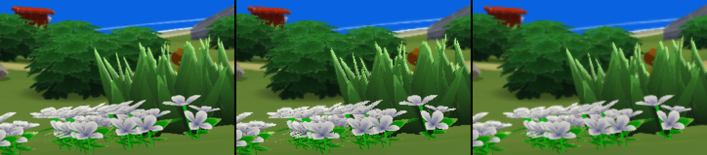

# Progress — Edge smoothing (FXAA) for lower render resolutions

[Product brief](PRD.md) · [Technical plan](TECH_PLAN.md) · [Progress](PROGRESS.md)

- 2026-11-24: the owner found the game runs much better at 2x on the Deck and saw barely any difference from 3x. The sizes worked out from the renderer's code (2x 1707×960, 3x 2560×1440, shown at 1280×720). FXAA chosen over SMAA for the first step; SMAA and multisampling noted as follow-ups.
- 2026-11-24: the code: RecompCore #69 (`aurora_set_fxaa`, `DOL_AURORA_FXAA`, levels 0 to 3), pinned here; the Display chooser "Edge smoothing (FXAA)" and its test entries. `settings_table_test` passes locally. Not yet built, run or measured: the shader has not been through the GPU's compiler.
- 2026-11-24: built (`5941dffe9`: main at 0.13.0 + #642 + #643 + #655 + #658 + this branch, RecompCore #68's head with #69's commit on top, two local diagnostics; an in-place rebuild of the trained test build) and run on a desktop from the Outset state, headless, High against Off at 2x and 3x plain. The shader compiles and the pass runs: no validation errors, the frames are 1707×960 at 2x and 2560×1440 at 3x as worked out, and the GPU profile shows "Smooth edges (FXAA)" at 0.05 ms a frame on the desktop's GPU (not the Deck's). The HUD is unchanged in the captures. A 240×160 crop of the grass and flowers, four times enlarged, 3x shrunk to 2x's size, then 2x, then 2x with High:

  

  The stair steps on the grass blades and petals at 2x are gone with the pass, about as at 3x shrunk; the bush's texture is a little softer than at plain 2x. Not yet run on the Deck.
