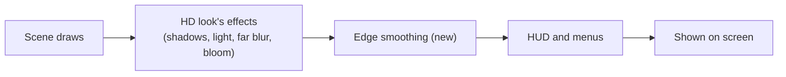

# Technical plan — Edge smoothing (FXAA) for lower render resolutions

[Product brief](PRD.md) · [Technical plan](TECH_PLAN.md) · [Progress](PROGRESS.md)

## Where the pass goes

Aurora's effects (`post_fx::encode()`, RecompCore) already run once a frame on the EFB after the scene and before the HUD: `common.cpp` splits the on-screen pass after its last perspective draw, or puts the effects just before the game's full-size frame copy, and draws the flat draws that follow (the HUD) afterwards. Every in-between frame of Smooth Motion is a frame of its own there and gets the effects too.

The smoothing is one more step at the end of that chain:

## Change (RecompCore #69), as written

In `post_fx.cpp`:

- `aurora_set_fxaa(int level)` and `DOL_AURORA_FXAA`: 0 off, 1 low, 2 medium, 3 high. The variable is read when the level is first asked for, after the host's settings are in the environment.
- `encode_fxaa()`: copies the frame buffer to a texture of its own (`CopyTextureToTexture`), then one full-screen pass reads the copy with the linear sampler and writes the frame buffer. The EFB's alpha is kept.
- It runs at the end of `encode()` for an ordinary frame (`Phase::Full`) and at the end of `encode_late()` for a monotone frame (Frozen Hyrule), so after bloom in both.
- Left out when the frame is multisampled or the target is not the frame buffer.
- `post_fx::any_enabled()` is true with the level above 0, so the scene pass is split before the HUD with the HD look off too.
- GPU profiler zone: "Smooth edges (FXAA)".

The shader follows FXAA's method (T. Lottes), written for this renderer in WGSL:

1. Brightness of the pixel and its four neighbours; if their range is under the level's threshold, the pixel is left as it is.
2. From the 3×3 brightness, whether the edge runs level or upright, and which side of the pixel it is on.
3. A walk along the edge both ways until the brightness leaves it, in steps that grow.
4. The lookup is shifted across the edge by how near the pixel is to the edge's nearer end, so a stair step becomes a ramp. A pixel that stands out from all its neighbours is blended a little with them (0.75 at every level).

| Level | Least edge (share of the brightest neighbour) | Least edge in the dark | Steps each way | Reach each way |
|---|---|---|---|---|
| Low | 0.25 | 0.0833 | 5 | 16.5 pixels |
| Medium | 0.166 | 0.0833 | 8 | 20.5 pixels |
| High | 0.125 | 0.0625 | 12 | 26.5 pixels |

`DOL_AURORA_FXAA_EDGE`, `_EDGE_MIN` and `_SUBPIXEL` set a level's values apart, for tuning before the levels are final.

## Change (BlueWake), as written

- `settings_table.h`: `DOL_AURORA_FXAA`, a chooser under Display after Texture filtering, fallback 0.
- `desktop_menu.cpp`: its choices (Off, Low, Medium, High), `aurora_set_fxaa()` at the first frame (`apply_live()`) and when the chooser moves (`apply_now()`).
- `tests/settings_table_test.cpp`: its place in the file order, and a case for its place, kind, fallback and that it needs no restart.
- The pin: RecompCore #69's head.

## Risks

- **Softness:** FXAA blends by brightness alone, so fine texture detail and thin lines can soften. The lone-pixel blend (0.75) is the part that does it; `DOL_AURORA_FXAA_SUBPIXEL` is there to try less.
- **What is drawn after the split:** the game's own flat draws after the scene (its distance blur's composite, screen fades) are not smoothed; they are soft by nature.
- **The game's frame copy:** where the effects go in before the game's full-size copy, the copy holds the smoothed scene (as it holds bloom today). The pause screen's background and the motion blur read that copy.
- **Cost at 3x and 4x:** a full-screen pass with up to 9 + 24 lookups a pixel on an edge; meant for 2x and under. To be measured.

## Verification, planned

On the owner's Deck in Game Mode, the owner's settings, the twelve states of #655 and #658, `render_bench --paced`, three labels on one build:

| Label | Render resolution | Edge smoothing |
|---|---|---|
| A | 3x | Off |
| B | 2x | Off |
| C | 2x | the level chosen from the pictures |

- Game frames a second and GPU time a shown frame, medians of four launches a scene, in percent against A.
- The pass's own GPU time from its profiler zone.
- Pictures: the same frame of each state under A, B and C, each shrunk to 1280×720 as the Deck shows it, side by side with differences, and a 1:1 crop of an edge.
- By eye on the Deck: HUD text, grass and rigging in motion, the pause screen.
