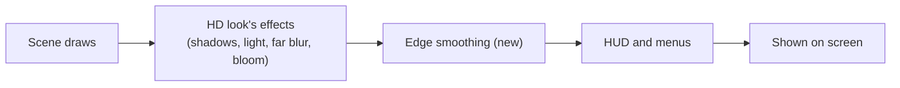
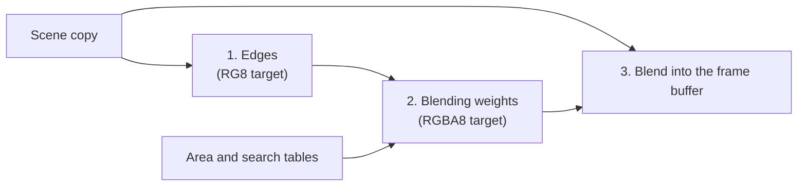

# Technical plan — Edge smoothing (FXAA) for lower render resolutions

[Product brief](PRD.md) · [Technical plan](TECH_PLAN.md) · [Progress](PROGRESS.md)

## Where the pass goes

Aurora's effects (`post_fx::encode()`, RecompCore) already run once a frame on the EFB after the scene and before the HUD: `common.cpp` splits the on-screen pass after its last perspective draw, or puts the effects just before the game's full-size frame copy, and draws the flat draws that follow (the HUD) afterwards. Every in-between frame of Smooth Motion is a frame of its own there and gets the effects too.

The smoothing is one more step at the end of that chain:

## Change (RecompCore #69), as written

In `post_fx.cpp`:

- `aurora_set_edge_smoothing(int mode)` and `DOL_AURORA_EDGE_SMOOTHING`: 0 off; 1 to 3 FXAA low, medium, high; 4 to 6 SMAA low, medium, high. The variable is read when the mode is first asked for, after the host's settings are in the environment. (The first build, the one benched on the Deck, had FXAA alone as `aurora_set_fxaa` and `DOL_AURORA_FXAA`, 0 to 3.)
- `encode_edge_smoothing()`: copies the frame buffer to a texture of its own (`CopyTextureToTexture`); FXAA is then one full-screen pass that reads the copy with the linear sampler and writes the frame buffer. The EFB's alpha is kept.
- It runs at the end of `encode()` for an ordinary frame (`Phase::Full`) and at the end of `encode_late()` for a monotone frame (Frozen Hyrule), so after bloom in both.
- Left out when the frame is multisampled or the target is not the frame buffer.
- `post_fx::any_enabled()` is true with the level above 0, so the scene pass is split before the HUD with the HD look off too.
- GPU profiler zones: "Smooth edges (FXAA)", "Smooth edges (SMAA)" with its three passes inside.

The shader follows FXAA's method (T. Lottes), written for this renderer in WGSL:

1. Brightness of the pixel and its four neighbours; if their range is under the level's threshold, the pixel is left as it is.
2. From the 3×3 brightness, whether the edge runs level or upright, and which side of the pixel it is on.
3. A walk along the edge both ways until the brightness leaves it, in steps that grow.
4. The lookup is shifted across the edge by how near the pixel is to the edge's nearer end, so a stair step becomes a ramp. A pixel that stands out from all its neighbours is blended a little with them (0.75 at every level).

| Level | Least edge (share of the brightest neighbour) | Least edge in the dark | Steps each way | Reach each way |
|---|---|---|---|---|
| Low | 0.25 | 0.0833 | 5 | 16.5 pixels |
| Medium | 0.166 | 0.0833 | 8 | 20.5 pixels |
| High | 0.125 | 0.0625 | 12 | 26.5 pixels |

`DOL_AURORA_FXAA_EDGE`, `_EDGE_MIN` and `_SUBPIXEL` set a level's values apart, for tuning before the levels are final.

### SMAA, as written (not yet built)

SMAA 1x ([iryoku/smaa](https://github.com/iryoku/smaa), MIT), its three passes written in WGSL for this renderer:

1. **Edges:** where a pixel's brightness steps from its left or upper neighbour by more than the threshold, unless a step beside it is more than twice as strong. Pixels with no edge are discarded.
2. **Weights:** for each edge pixel, how long the edge line runs each way and what crosses its ends; the area table turns that shape into how much of the pixel the true edge covers. The search table lets one lookup cover two pixels.
3. **Blend:** each pixel mixed with the neighbour across its strongest edge by that coverage. Pixels away from edges are copied as they are, which is why SMAA softens textures less than FXAA.

| Level | Threshold | Lookups each way (two pixels each) | Diagonals | Corners kept |
|---|---|---|---|---|
| Low | 0.15 | 4 | no | no |
| Medium | 0.1 | 8 | no | no |
| High | 0.1 | 16 | 8 lookups | yes |

These are the original's Low, Medium and High presets. `smaa_tables.hpp` holds the two tables with the original's notice: the search table whole (64×16), and the first 160×80 part of the area table, which is all that SMAA 1x reads (26 KB in place of 179 KB). `DOL_AURORA_SMAA_THRESHOLD` sets a level's threshold apart.

## Change (BlueWake), as written

- `settings_table.h`: `DOL_AURORA_EDGE_SMOOTHING`, a chooser under Display after Texture filtering, fallback 0.
- `desktop_menu.cpp`: its choices (Off; FXAA Low, Medium, High; SMAA Low, Medium, High), `aurora_set_edge_smoothing()` at the first frame (`apply_live()`) and when the chooser moves (`apply_now()`).
- `tests/settings_table_test.cpp`: its place in the file order, and a case for its place, kind, fallback and that it needs no restart.
- The pin: RecompCore #69's head.

## Risks

- **Softness:** FXAA blends by brightness alone, so fine texture detail and thin lines can soften. The lone-pixel blend (0.75) is the part that does it; `DOL_AURORA_FXAA_SUBPIXEL` is there to try less.
- **What is drawn after the split:** the game's own flat draws after the scene (its distance blur's composite, screen fades) are not smoothed; they are soft by nature.
- **The game's frame copy:** where the effects go in before the game's full-size copy, the copy holds the smoothed scene (as it holds bloom today). The pause screen's background and the motion blur read that copy.
- **Cost at 3x and 4x:** a full-screen pass with up to 9 + 24 lookups a pixel on an edge; meant for 2x and under. To be measured.

## MSAA probe, as written (RecompCore #69)

- `DOL_AURORA_MSAA=4` (startup, in the Aurora backend) sets `AuroraConfig::msaa`, which nothing set before; WebGPU allows 1 or 4 samples, so other values leave it off. Not in the menu.
- Under it the EFB depth is multisampled. Before an EFB depth copy or the depth peek reads it, one full-screen pass writes sample 0 of each pixel to a single-sample depth of the same size (`resolve_msaa_depth` in `common.cpp`), and both read that. Sample 0 rather than an average, so a copied depth is one the scene had.
- Still off under it: every effect that reads the depth (ambient occlusion, sun and cloud shadows, edge light, far blur, bloom, exposure, the sea mask), the monotone's colour, and the edge smoothing filters. Keeping them would mean making that single-sample depth once a frame for all of them: the larger step, not taken.

## Verification, as done so far

**On the owner's Deck, its own screen** (Game Mode, the owner's settings with the HD texture pack, twelve states, `render_bench --paced`, build `e40240187`), both methods: 3x as the base, then 2x Off and each of the six levels, two launches a setting and scene. Numbers: [Progress](PROGRESS.md).

- 2x against 3x: about a third less GPU time (half in the lava room); every scene at full speed, where 3x leaves four below it.
- The smoothing: no change in game frames a second at any level; its own GPU time a pass FXAA 0.48 / 0.55 / 0.63 ms, SMAA 0.79 / 0.85 / 0.95 (medians), twice that a game frame with Smooth Motion on.

(An earlier FXAA-only run, run while the Deck was docked to a 1080p screen, gave the same picture for fps; it is in Progress and superseded here.)

**On a desktop, with the owner's HD texture pack** (headless, build `e40240187`): pictures of the twelve states at 2x Off and each level, compared with 2x Off at 1280×720. Every level stays 42 to 62 dB from plain 2x (medians 49.0 to 51.1); the changes sit on edges only.

**MSAA probe on a desktop** (build `2373cd97f`): twelve states at 2x with and without 4x MSAA, depth-reading effects off in both, all clean; MSAA moves the picture 37 to 50 dB from 2x Off in ten scenes, much more than either filter.

**Still to do**

- By eye on the Deck: HUD text, grass and rigging in motion, the pause screen (the owner, so far: "barely any difference").
- MSAA's GPU cost on the Deck, if it is to go further.
- The crash at shutdown seen once in eight desktop runs of SMAA Low (two repeats clean; none since in 84 + 24 desktop runs).
