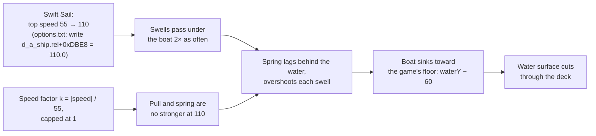
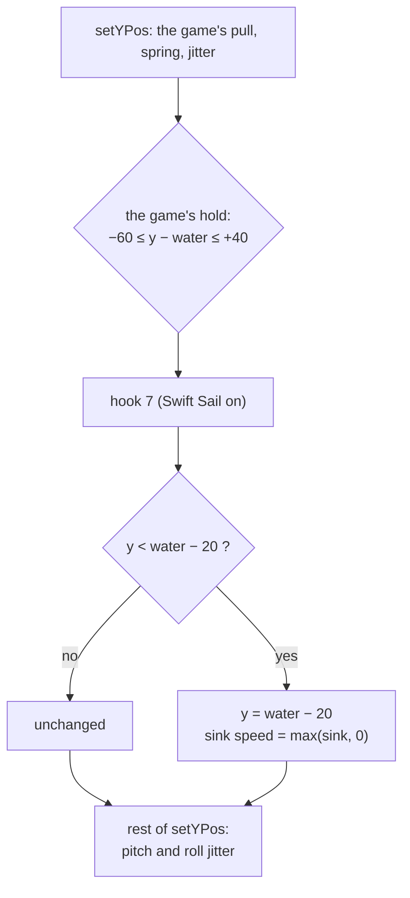

# Technical plan — A steadier boat with Swift Sail

## Where the boat's height comes from

Each frame the boat actor `daShip_c` sets its height on the water in `daShip_c::setYPos` (`d_a_ship.rel`, `.text 0x23E0`; the public decompilation, zeldaret/tww `src/d/actor/d_a_ship.cpp`, line 887). While sailing:

```cpp
f32 k = std::abs(speedF) / 55.0f;          // speed factor, capped at 1
if (k > 1.0f) k = 1.0f;

pos.y += k * ((waterY - pos.y) * 0.1f);    // 1. pull 10 % of the gap, scaled by speed
m03D0 += (waterY - pos.y) * 0.05f;         // 2. spring: vertical speed gains 5 % of the gap
m03D0  = clamp(m03D0, -20, 20);
pos.y += m03D0;                            // 3. apply the spring's speed
pos.y += k * 0.25f * sin(m03B0) + 0.6f;    // 4. small idle jitter
cLib_addCalc(&m03D0, 0, 0.05, 1, 0.05);    // 5. the spring slowly calms down

if (pos.y > waterY + 40) pos.y = waterY + 40;       // 6. the game's hold:
else if (pos.y < waterY - 60) pos.y = waterY - 60;  //    40 above, 60 below
```

`waterY` (`m03F4`) is the sea's height under the boat, from `daSea_calcWave`.

## Why Swift Sail makes it worse



At 55 the spring keeps up with the swells. At 110 the water rises and falls under the boat twice as fast while the spring is no stronger: it falls behind, overshoots each trough, and the boat dives deep into the swell. The deck sits well under 60 units above the boat's origin, so at that depth the sea shows through.

```
            normal speed                         Swift Sail, before the fix
   ~~~~~~~/‾‾‾‾‾\~~~~~~~ water           ~~~~~~~~~~~~~~~~~~~~~~~ water ← cuts the deck
         \_______/       boat                   /‾‾‾‾‾\
     (rides within a few units)                \_______/  up to 60 units under
```

## Change: one hook after the game's hold

Better Wind Waker's settings are listed in `mods/betterww/options.txt` as sites DolRecomp translates both ways (`--option-sites`, `patches/dolrecomp/0019`), with a runtime switch picking one; a `hook` runs native host code before an instruction. A new line joins Swift Sail's hooks:

```
hook  d_a_ship.rel+0x2788 swift_sail before 7    # lfs f1, 0x10C(r31) in setYPos, after his height is held to the water
```

`0x2788` is a file offset in the module; its code section starts at file offset `0xF4`, so this is `.text 0x2694`, the instruction where both arms of the game's hold meet (`r30` the boat, `r31` the module's constants):

```
2660: lfs   f2, 0x1FC(r30)    ; pos.y
2664: lfs   f0, 0x104(r31)    ; 40.0
2668: lfs   f1, 0x3F4(r30)    ; waterY
266c: fadds f0, f0, f1        ; waterY + 40
2670: fcmpo cr0, f2, f0
2674: bf    gt, 0x2680
2678: stfs  f0, 0x1FC(r30)    ; too high → hold at +40
267c: b     0x2694  ─────────────────┐
2680: lfs   f0, 0x108(r31)    ; 60.0 │
2684: fsubs f0, f1, f0        ; waterY − 60
2688: fcmpo cr0, f2, f0              │
268c: bf    lt, 0x2694  ─────────────┤
2690: stfs  f0, 0x1FC(r30)    ; too low → hold at −60
2694: lfs   f1, 0x10C(r31)  ◄────────┘  hook 7 runs here, before this instruction
```

A site is a block of its own in the translation, so the branch target is no problem. In the translated module (`chunks_mod_betterww/chunks_d_a_ship_168__chunk_0000_rel1_C1B100F4.c` in a build) it sits behind Swift Sail's switch (flag 2):

```c
if (dolrecomp_option_flags[2u]) {
    const u32 hook_next = dolrecomp_native_hook(ctx, 7u);
    ...
```

## The native code

`runtime/host/src/game_options.c`, `hook_sail_steady`: `r30` is the boat; it reads three fields, applies the rule, and writes them back.

| Field | Offset | Meaning |
|---|---|---|
| `current.pos.y` | `0x1FC` | the boat's height |
| `m03D0` | `0x3D0` | the spring's vertical speed |
| `m03F4` | `0x3F4` | the water's height under it |

`runtime/host/src/sail_steady.h` holds the rule as a pure function, so it can be tested without the game:

```c
#define SAIL_STEADY_DEPTH 20.0f

static inline int sail_steady(float* y, float water, float* sink) {
    const float lowest = water - SAIL_STEADY_DEPTH;
    if (!(*y < lowest))
        return 0;            // at or above the new floor: untouched
    *y = lowest;             // hold at 20 under the water
    if (*sink < 0.0f)
        *sink = 0.0f;        // and stop the spring pushing further down
    return 1;
}
```

Clearing the downward spring speed matters: without it `m03D0` would keep driving the boat into the floor every frame, and it would stick there instead of springing back.



Brisk Sail turns Swift Sail's sites on, so it gets the hook too.

## What it doesn't touch

- Speed, steering, the wind, braking and collisions: other code and other fields. Only the drawn height and its spring speed are written.
- Riding above the water: the game's +40 is unchanged.
- The tilt on the waves (`setWaveAngle`, `.text 0x1E9C`): unchanged. If the bobbing still feels strong once the clipping is gone, that is the next place to look.
- With Swift Sail off, the hook does not run.

## Risks

- **Too stiff:** at 20 the boat may look glued to the water in big swells. `SAIL_STEADY_DEPTH` is the one constant to tune; the owner judges on the Deck.
- **Only the sinking:** if the bobbing still looks strong, the tilt and the spring's strength come next.

## Verification

- `tests/sail_steady_test.c` (the audit workflow, under sanitizers): untouched on, above and at the floor; held below it with the downward speed stopped; a rising boat keeps its rise; negative heights. Passes locally.
- `scripts/mods/game_options.py check` reads the list (18 options, 41 sites).
- The hook appears in the build's translated `d_a_ship` code behind Swift Sail's switch.
- Still to do: the owner sails on the Deck with Swift Sail at full speed.
